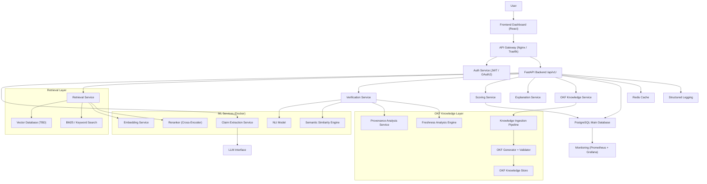
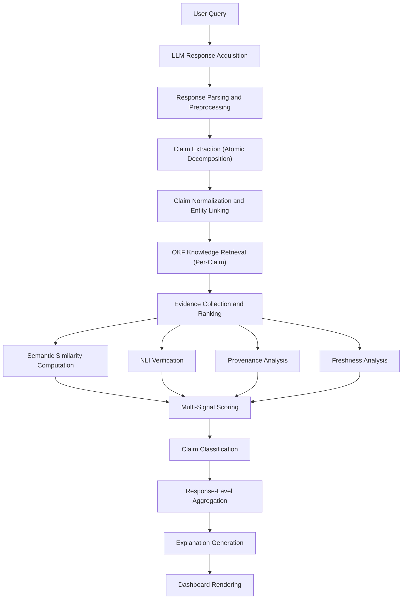
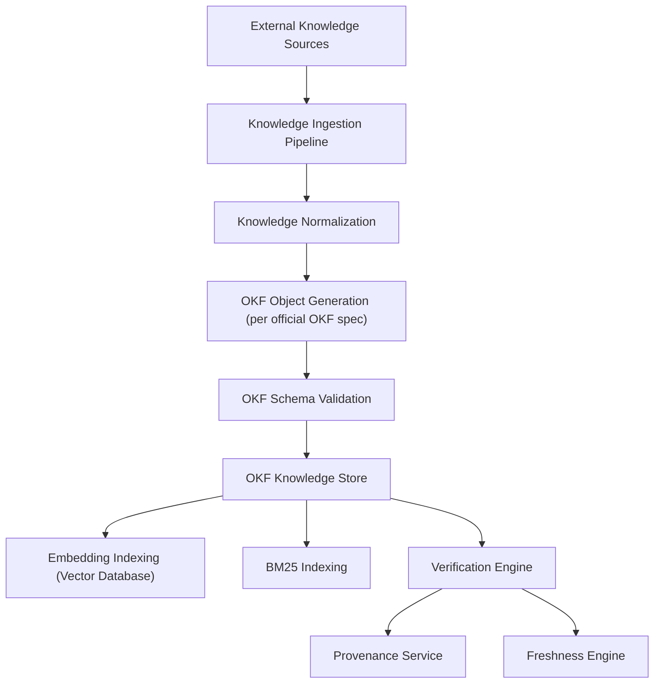
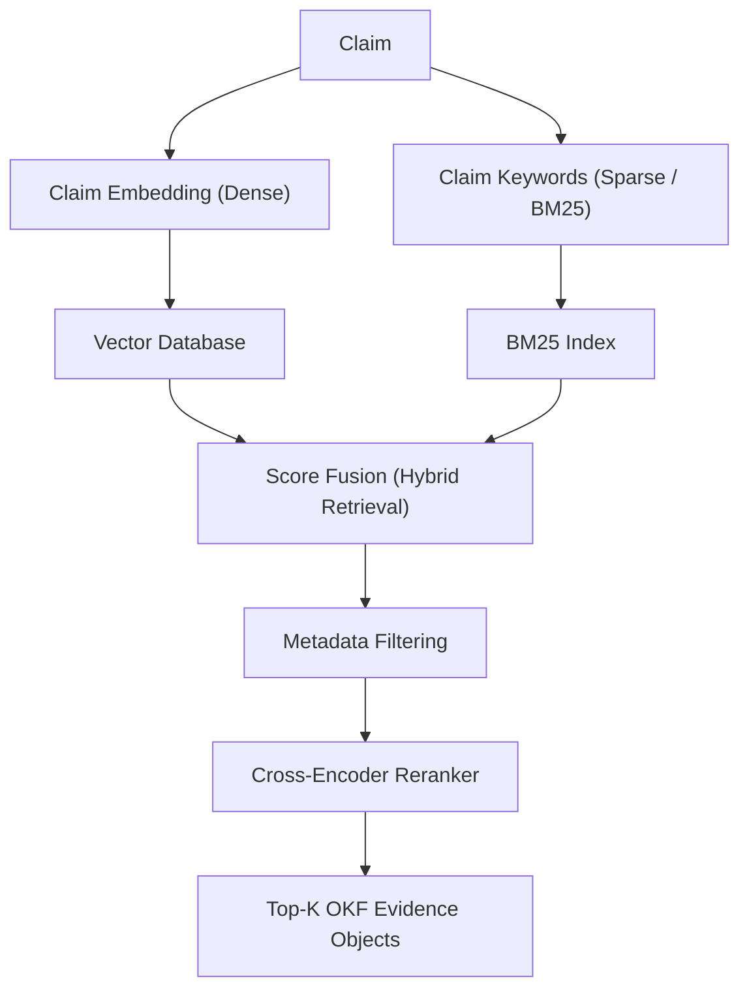
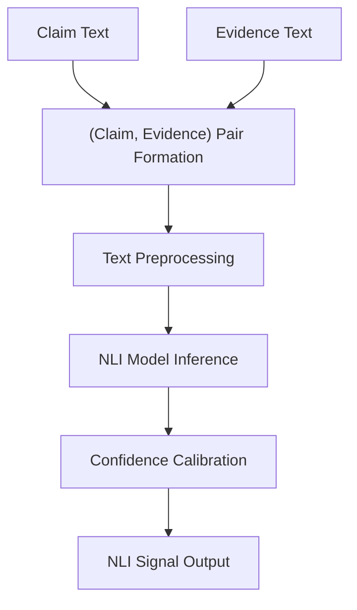
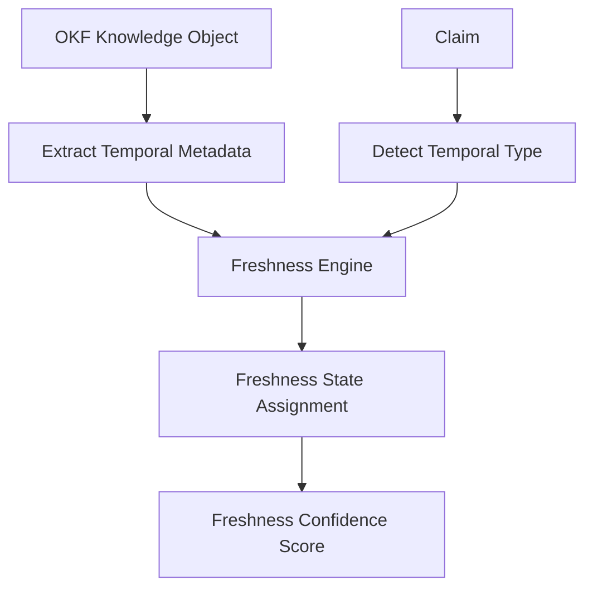
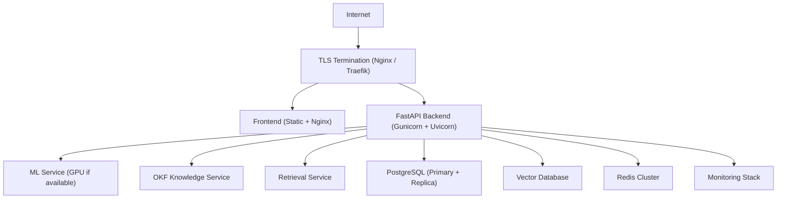

# HalluciGuard-OKF

> **Explainable Open Knowledge Format-Based LLM Hallucination Detection and Verification Framework**

[-orange)](.) [](.) [](.) [](.) [](./LICENSE)

> **Current status (2026-11-05):** This README includes historical design and aspirational criteria; it is not a claim that all listed research work is complete. The active runtime uses rule-based NLI and TF-IDF retrieval in the tested environment. Current code status, reproducible custom-benchmark results, and remaining gaps are in [`documentation/IMPLEMENTATION_STATUS.md`](documentation/IMPLEMENTATION_STATUS.md) and [`documentation/RESEARCH_REPORT.md`](documentation/RESEARCH_REPORT.md). The sample JSON below is illustrative, not a saved model output. The latest test run was 38/38 passing; external benchmarks and a full perturbation study have not been run.

---

> **README STATUS LEGEND**
>
> Throughout this document, features are marked as:
> - ✅ **Implemented** — exists in the repository and is tested
> - 🔲 **Planned** — intended but not yet implemented
> - 🧪 **Experimental** — under active research/evaluation
> - 📐 **Proposed** — future architecture, not yet approved
> - **TBD** — decision required by the team before proceeding

---

## Table of Contents

1. [Overview](#1-overview)
2. [Problem Statement](#2-problem-statement)
3. [Motivation](#3-motivation)
4. [Research Objective](#4-research-objective)
5. [Research Questions](#5-research-questions)
6. [Novelty](#6-novelty)
7. [Key Contributions](#7-key-contributions)
8. [System Architecture](#8-system-architecture)
9. [End-to-End Workflow](#9-end-to-end-workflow)
10. [OKF Knowledge Architecture](#10-okf-knowledge-architecture)
11. [Claim Extraction](#11-claim-extraction)
12. [Evidence Retrieval](#12-evidence-retrieval)
13. [NLI Verification](#13-nli-verification)
14. [Provenance and Freshness](#14-provenance-and-freshness)
15. [Hallucination Scoring Engine](#15-hallucination-scoring-engine)
16. [Explainability](#16-explainability)
17. [Dataset Strategy](#17-dataset-strategy)
18. [Benchmark](#18-benchmark)
19. [Experimental Design](#19-experimental-design)
20. [Baselines](#20-baselines)
21. [Ablation Studies](#21-ablation-studies)
22. [Error Analysis](#22-error-analysis)
23. [Technology Stack](#23-technology-stack)
24. [Repository Structure](#24-repository-structure)
25. [Backend](#25-backend)
26. [Frontend](#26-frontend)
27. [Database](#27-database)
28. [API Specification](#28-api-specification)
29. [ML Pipeline](#29-ml-pipeline)
30. [Notebook Pipeline](#30-notebook-pipeline)
31. [Security](#31-security)
32. [Privacy](#32-privacy)
33. [MLOps](#33-mlops)
34. [Testing](#34-testing)
35. [Deployment](#35-deployment)
36. [Monitoring and Observability](#36-monitoring-and-observability)
37. [Performance Requirements](#37-performance-requirements)
38. [Development Phases](#38-development-phases)
39. [Team Collaboration](#39-team-collaboration)
40. [AI Agent Instructions](#40-ai-agent-instructions)
41. [Definition of Done](#41-definition-of-done)
42. [Reproducibility](#42-reproducibility)
43. [Limitations](#43-limitations)
44. [Future Work](#44-future-work)
45. [Quick Start](#45-quick-start)
46. [Example End-to-End Request](#46-example-end-to-end-request)
47. [Success Criteria](#47-success-criteria)

---

## 1. Overview

### Executive Summary

Large Language Models (LLMs) generate responses that can be factually incorrect — a phenomenon widely known as **hallucination**. While LLMs are increasingly deployed in knowledge-intensive applications, the inability to reliably detect and explain hallucinations constitutes a fundamental reliability risk.

Existing detection approaches suffer from a critical architectural flaw: they classify entire responses as "hallucinated" or "not hallucinated" using shallow features such as cosine similarity to retrieved text, or by delegating judgment to another LLM without structured evidence. This response-level binary classification fails to:

- Identify **which specific claim** is wrong
- Explain **why** the claim is wrong
- Distinguish between **contradiction** and **insufficient evidence**
- Account for the **temporal validity** of knowledge
- Track the **provenance** of supporting evidence
- Produce auditable, interpretable outputs

**HalluciGuard-OKF** addresses these gaps by proposing a **claim-level hallucination detection and evidence verification framework** that uses **Google's Open Knowledge Format (OKF)** as a structured, provenance-aware knowledge layer.

The system decomposes LLM responses into atomic factual claims, retrieves structured OKF knowledge objects relevant to each claim, performs semantic and NLI-based verification against that evidence, tracks provenance and temporal validity, computes a multi-signal hallucination score, and generates an interpretable explanation for every decision.

### Illustrative Example

**User Query:**
> Who founded Tesla?

**LLM Response:**
> Tesla was founded in 2008 by Elon Musk.

**System Behavior:**

| Step | Action | Result |
|------|--------|--------|
| 1 | Decompose response into claims | Claim C001: "Tesla was founded in 2008" · Claim C002: "Tesla was founded by Elon Musk" |
| 2 | Retrieve relevant OKF knowledge | OKF object: Tesla founding records |
| 3 | Inspect evidence and provenance | Source: Official Tesla history; Verified; Timestamp: 2003 |
| 4 | Check knowledge freshness | Historical fact; no staleness risk |
| 5 | Semantic similarity + NLI verification | C001 contradicted (founded 2003); C002 partially supported (co-founder) |
| 6 | Classify each claim | C001: `CONTRADICTED`, C002: `UNVERIFIED` (Musk was co-founder, not sole founder) |
| 7 | Compute hallucination score | 0.61 (partially hallucinated) |
| 8 | Generate explanation | "Tesla was founded in 2003, not 2008. Elon Musk was one of five co-founders, not the sole founder." |

---

## 2. Problem Statement

### Formal Problem Definition

> Given a user query `Q` and an LLM-generated response `R`, identify the set of atomic factual claims `{C1, C2, ..., Cn}` present in `R`, verify each claim against structured and provenance-aware knowledge, determine whether each claim is **SUPPORTED**, **CONTRADICTED**, or **UNVERIFIED**, and produce an interpretable hallucination score with supporting evidence and reasoning.

### Limitations of Existing Approaches

| Approach | Limitation |
|---|---|
| Response-level binary classification | Cannot identify which claim is wrong; poor precision |
| Keyword matching | Misses semantic equivalence; brittle |
| Cosine similarity alone | Conflates relevance with factual correctness; no contradiction detection |
| LLM-as-a-judge | Opaque reasoning; recursive hallucination risk; no provenance |
| Conventional RAG without provenance | Cannot distinguish retrieved text quality or source reliability |
| No freshness awareness | Cannot detect temporally stale facts |
| Binary evidence model | Collapses "no evidence" with "contradicted evidence" — a critical logical error |
| No explainability | Cannot produce auditable decisions |

### Core Logical Flaw in Prior Work

A fundamental error in many existing systems:

```
No evidence retrieved → Claim classified as FALSE (hallucination)
```

This is **logically invalid**. Absence of evidence is not evidence of falsity. The correct three-way treatment:

```
SUPPORTED     → Evidence confirms the claim
CONTRADICTED  → Evidence explicitly contradicts the claim
UNVERIFIED    → Insufficient or no evidence to decide
```

This distinction must propagate through every layer of the system.

---

## 3. Motivation

### Why Claim-Level?

A response such as "Marie Curie won the Nobel Prize in Physics in 1911" contains an independently verifiable claim. Classifying the entire response as "hallucinated" because one claim is wrong destroys precision. A claim-level system correctly identifies each claim independently.

### Why Structured Knowledge?

Unstructured text retrieved via RAG provides tokens but not structure. Structured knowledge allows:
- **Provenance tracking**: Where does this fact come from?
- **Verification status**: Has this fact been independently verified?
- **Temporal metadata**: When was this fact valid? Is it still current?
- **Relational context**: How does this fact relate to other known facts?

### Why OKF?

Google's Open Knowledge Format (OKF) is a structured knowledge representation format that supports machine-readable knowledge objects with provenance, source attribution, lifecycle/freshness metadata, verification status, and relational context.

> **Important Architectural Clarification:**
>
> OKF is **not** a replacement for RAG. These are orthogonal concepts:
> - **RAG (Retrieval-Augmented Generation)** = a *retrieval and generation architecture*
> - **OKF** = a *structured knowledge representation and exchange format*
>
> This system may use retrieval mechanisms (BM25, dense vector search, hybrid) to **locate** relevant OKF knowledge objects. The research contribution is the use of structured, provenance-aware OKF artifacts as the evidence layer for hallucination verification.

---

## 4. Research Objective

### Primary Objective

To design, implement, evaluate, and analyze an explainable claim-level hallucination detection framework that uses Google's Open Knowledge Format (OKF) as a structured, provenance-aware knowledge layer for evidence verification, and to determine whether OKF-structured knowledge improves hallucination detection accuracy, evidence traceability, and decision explainability compared to unstructured retrieval baselines.

### Secondary Objectives

1. Develop a reusable claim extraction pipeline for LLM response decomposition
2. Build an OKF knowledge ingestion, normalization, and validation pipeline
3. Design a configurable multi-signal hallucination scoring engine
4. Produce interpretable, evidence-backed explanations for every verification decision
5. Create a custom hallucination benchmark dataset covering multiple claim categories
6. Evaluate the system against established baselines using rigorous metrics
7. Conduct ablation studies to identify the contribution of each system component
8. Deliver a production-ready, containerized implementation

---

## 5. Research Questions

### RQ1 — Claim-Level vs. Response-Level

> Can claim-level verification improve hallucination detection precision and recall compared with response-level binary classification?

**Hypothesis:** Claim-level decomposition improves precision by isolating incorrect facts within otherwise correct responses.

**Evaluation:** Precision, Recall, F1 at both claim and response level on the custom benchmark.

### RQ2 — OKF Structured Knowledge

> Does using OKF-structured knowledge objects improve evidence traceability compared to unstructured retrieved text?

**Hypothesis:** Structured OKF artifacts expose provenance, source type, and verification status unavailable in raw text chunks.

**Evaluation:** Qualitative audit; provenance coverage rate; Experiment C (RAG+NLI) vs. Experiment D (OKF+NLI).

### RQ3 — Provenance-Aware Verification

> Does incorporating source provenance information improve verification reliability?

**Hypothesis:** Evidence from higher-reliability, verified sources produces more accurate classification.

**Evaluation:** Ablation removing provenance signals; F1 comparison with/without provenance weighting.

### RQ4 — Freshness-Aware Detection

> Does temporal metadata from OKF knowledge objects help detect temporally stale hallucinations?

**Hypothesis:** A freshness-aware system correctly classifies stale claims, while freshness-unaware systems classify them as SUPPORTED.

**Evaluation:** Benchmark temporal hallucination subset; freshness-aware vs. freshness-unaware comparison.

### RQ5 — Multi-Signal Verification

> Does combining semantic similarity with NLI signals improve detection performance over either signal alone?

**Hypothesis:** Their combination improves both precision and recall over either alone.

**Evaluation:** Experiments A (similarity), B (NLI), F (combined).

### RQ6 — Explainability

> Can the system generate concise, auditable explanations useful to human reviewers?

**Hypothesis:** Evidence-backed, provenance-attributed explanations are more useful than binary labels.

**Evaluation:** Human evaluation; qualitative analysis; explanation faithfulness assessment.

---

## 6. Novelty

### 6.1 Claim-Level Hallucination Detection

```
Prior Approach:
  Response -> [Hallucinated | Not Hallucinated]

HalluciGuard-OKF:
  Response
    (down) Claim Extraction
  {C1, C2, ..., Cn}
    (down) Per-Claim Verification
  {C1: SUPPORTED, C2: CONTRADICTED, C3: UNVERIFIED, ...}
    (down) Aggregation
  Response-level Score + Per-Claim Explanations
```

### 6.2 OKF-Based Knowledge Verification Layer

The use of Google's Open Knowledge Format as a structured, provenance-aware evidence medium for hallucination verification is the **central architectural novelty** of this work.

OKF knowledge objects can represent:
- Factual entities and their properties
- Relationships between entities
- Temporal scope and validity periods
- Source attribution and provenance chains
- Verification and confidence metadata
- Knowledge lifecycle and freshness information

> **Compliance Note:** The implementation must follow the **official OKF specification** for the version selected by the team. Do **not** invent OKF fields or capabilities.
>
> **TBD — Decision Required:** OKF version selection must be confirmed before schema design begins. Record in `configs/okf_version.yaml`.

### 6.3 Provenance-Aware Verification

The system interrogates:
- **Source**: What entity published this knowledge?
- **Source type**: Primary, secondary, aggregated, synthesized?
- **Verification status**: Has this knowledge been independently verified?
- **Timestamp**: When was this knowledge recorded?
- **Provenance chain**: Can the evidence be traced back to primary sources?

### 6.4 Freshness-Aware Hallucination Detection

A claim may be historically correct but currently false. The system distinguishes:

| Freshness State | Meaning |
|---|---|
| `CURRENT` | Knowledge is within its declared validity period |
| `HISTORICAL` | Knowledge was valid at a specific past time |
| `STALE` | Knowledge was once current but validity has expired |
| `UNKNOWN` | Temporal validity cannot be determined |

### 6.5 Three-Way Claim Classification

```
SUPPORTED     → Evidence confirms the claim with acceptable confidence
CONTRADICTED  → Evidence explicitly contradicts the claim
UNVERIFIED    → Evidence is absent, ambiguous, or insufficient
```

Optional metadata flags (not replacing core classification):
- `LOW_CONFIDENCE` — classification made with low confidence
- `STALE` — classification may be invalidated by knowledge freshness

### 6.6 Multi-Signal Hallucination Scoring

| Signal | Description |
|---|---|
| Semantic similarity | Embedding-based cosine similarity between claim and evidence |
| NLI entailment | Probability that evidence entails the claim |
| NLI contradiction | Probability that evidence contradicts the claim |
| Evidence quality | Coverage, specificity, and relevance |
| Source reliability | Estimated reliability of the evidence source |
| Provenance confidence | Confidence from provenance metadata |
| Knowledge freshness | Temporal validity assessment |
| Retrieval confidence | Confidence in relevance of retrieved knowledge |
| Claim confidence | Confidence in claim extraction accuracy |

> **Important:** Exact scoring formula, weights, normalization, and thresholds must be determined experimentally. Thresholds must be calibrated on a held-out validation set. No weights should be hardcoded without validation evidence.

---

## 7. Key Contributions

The following are **expected contributions**. They must not be claimed as validated until experimental results confirm them.

1. 🔲 Claim-Level Hallucination Detection Pipeline
2. 🔲 OKF Integration Framework
3. 🔲 Provenance-Aware Factuality Assessment
4. 🔲 Freshness-Aware Temporal Verification
5. 🔲 Multi-Signal Hallucination Scoring
6. 🔲 Explainable Evidence-Backed Decisions
7. 🔲 Custom Hallucination Benchmark
8. 🔲 Comparative Evaluation Against Baselines
9. 🔲 Ablation Analysis
10. 🔲 Production-Ready Implementation

---

## 8. System Architecture

### High-Level Architecture Diagram



> **TBD — Decision Required:** Vector database selection, primary LLM provider, NLI model, embedding model.

### Component Responsibilities

| Component | Responsibility |
|---|---|
| Frontend | Query input, result visualization, claim breakdown, evidence display, provenance panel |
| API Gateway | TLS termination, rate limiting, routing, request tracing |
| Auth Service | JWT issuance, validation, OAuth2, RBAC enforcement |
| FastAPI Backend | Core API, orchestration, request/response handling |
| Claim Extraction Service | LLM-based decomposition of responses into atomic claims |
| OKF Knowledge Service | Knowledge ingestion, OKF generation, validation, storage |
| Retrieval Service | Hybrid retrieval of OKF knowledge objects |
| Verification Service | NLI, semantic similarity, provenance, freshness analysis |
| Scoring Service | Multi-signal hallucination score computation |
| Explanation Service | Human-readable explanation generation |
| PostgreSQL | Persistent storage for users, analyses, claims, evidence, results |
| Vector Database | Embedding index for dense retrieval |
| Redis | Caching, rate limiting state |

---

## 9. End-to-End Workflow



### Stage Descriptions

**Stage 1 — Response Acquisition.** Accept structured input: `{query, response, llm_model, request_id, metadata}`.

**Stage 2 — Response Parsing.** Sentence segmentation, language detection, encoding normalization, structural parsing.

**Stage 3 — Claim Extraction.** Convert response into atomic, independently verifiable factual claims.

Output schema (per claim):
```json
{
  "claim_id": "C001",
  "claim_text": "Tesla was founded in 2008.",
  "claim_type": "temporal",
  "source_sentence": "Tesla was founded in 2008 by Elon Musk.",
  "entities": [{"name": "Tesla", "type": "ORG"}, {"name": "2008", "type": "DATE"}],
  "temporal_reference": {"type": "absolute", "value": "2008"},
  "extraction_confidence": 0.97
}
```

**Stage 4 — Claim Normalization.** Normalize entities, resolve coreferences, link to knowledge base identifiers, normalize temporal expressions.

**Stage 5 — OKF Knowledge Retrieval.** Retrieve most relevant OKF knowledge objects using hybrid retrieval.

**Stage 6 — Evidence Collection and Ranking.** Top-K OKF objects, reranking, provenance and freshness metadata collection.

**Stage 7 — Semantic Similarity.** Cosine similarity between claim and evidence embeddings. One signal only.

**Stage 8 — NLI Verification.** (claim, evidence) pairs → NLI model → P(Entailment), P(Neutral), P(Contradiction).

**Stage 9 — Provenance Analysis.** Source type, reliability, verification status, provenance chain completeness.

**Stage 10 — Freshness Analysis.** Knowledge validity period, temporal claim type, freshness state assignment.

**Stage 11 — Multi-Signal Scoring.** Aggregate signals into claim-level hallucination score.

**Stage 12 — Claim Classification.** SUPPORTED / CONTRADICTED / UNVERIFIED with optional metadata flags.

**Stage 13 — Response-Level Aggregation.** Aggregate claim results into response-level metrics.

**Stage 14 — Explanation Generation.** Evidence-backed explanation per claim.

**Stage 15 — Dashboard Rendering.** Interactive frontend display.

---

## 10. OKF Knowledge Architecture

### Architectural Role



### OKF Compliance Requirements

> **Critical:** All OKF artifacts must conform to the official OKF specification for the version selected by the team. Do **not** invent fields, schemas, or capabilities not in the specification.
>
> **TBD — Decision Required:** Select OKF specification version. Document in `docs/okf_integration.md` and `configs/okf_version.yaml`.

Required documentation in `docs/okf_integration.md`:
- OKF version selected
- Schema fields used from the specification
- Any project-specific extensions (clearly namespaced)
- Validation tooling and test cases

### OKF Object Field Categories

| Field Category | Purpose |
|---|---|
| Identity | Unique identifier |
| Content | The factual claim or entity description |
| Source | Where this knowledge came from |
| Provenance | Chain of attribution |
| Temporal | Validity period or timestamp |
| Verification | Verification status and confidence |
| Relationships | Connections to other knowledge objects |
| Lifecycle | Freshness and status metadata |

> **TBD:** Exact field names and types must come from the official OKF specification.

### OKF Validation Requirements

Every generated OKF artifact must be:
1. Validated against the official OKF schema
2. Rejected if invalid (error logged)
3. Logged with a validation result ID
4. Never stored if validation fails

### Knowledge Store Architecture

| Storage Layer | Content |
|---|---|
| PostgreSQL | OKF object metadata, provenance records, verification status |
| File System / Object Store | Full OKF JSON artifacts |
| Vector Database | Embedding representations for dense retrieval |
| BM25 Index | Inverted index for keyword retrieval |

---

## 11. Claim Extraction

### Supported Claim Types

| Claim Type | Description | Hallucination Risk |
|---|---|---|
| `factual` | General factual assertions | Entity-attribute errors |
| `numerical` | Numeric values, statistics, measurements | Precision errors, magnitude errors |
| `temporal` | Date, time, duration, sequence | Year/date errors, sequence reversal |
| `entity` | Entity identity, classification, membership | Wrong entity type or name |
| `attribution` | Credit, authorship, origination | Wrong person/organization |
| `causal` | Cause-effect relationships | Spurious causation, reversed causation |
| `relational` | Relationships between entities | Wrong relationship type or direction |
| `geographic` | Location, region, country assertions | Wrong location |
| `comparative` | Comparative assertions | Reversed comparison, wrong baseline |

**TBD — Decision Required:** LLM for claim extraction, fine-tuned vs. few-shot prompting, multilingual strategy.

### Claim Extraction Quality Evaluation

Must be separately evaluated on: extraction recall, extraction precision, atomicity, and schema compliance.

---

## 12. Evidence Retrieval

### Architectural Principle

> OKF = Knowledge Representation Format
> Retrieval = Knowledge Access Mechanism

These are complementary, not competing.

### Retrieval Architecture



### Retrieval Failure Handling

If no relevant OKF knowledge found:
- Claim receives `UNVERIFIED` (not `CONTRADICTED`)
- Retrieval confidence = 0.0
- Explanation explicitly states evidence not found
- **Never** treated as proof the claim is false

---

## 13. NLI Verification

### NLI Architecture



**TBD — Decision Required:** NLI model selection based on benchmark performance, latency, domain fit, and compute budget.

Candidate architectures (not yet selected): DeBERTa-v3-large, RoBERTa-large-mnli, BART-large-MNLI, domain-specific fine-tuned model.

### NLI Interpretation

| NLI Output | Interpretation |
|---|---|
| High P(Entailment) | Evidence supports the claim |
| High P(Contradiction) | Evidence contradicts the claim |
| High P(Neutral) | Evidence related but neither supports nor contradicts |
| All low | Evidence irrelevant to the claim |

### NLI Limitations

NLI models must not be treated as ground truth. They struggle with: numeric facts, temporal claims, multi-hop reasoning, out-of-distribution examples. NLI output must always be one signal among many.

---

## 14. Provenance and Freshness

### Provenance Tracking

| Provenance Field | Description |
|---|---|
| Source name | Name of the originating source |
| Source URL | Canonical URL if applicable |
| Source type | Primary, secondary, aggregated, synthesized |
| Verification status | Verified, unverified, disputed |
| Ingestion timestamp | When the knowledge was ingested |
| Author/Publisher | Entity responsible for the knowledge |
| License | Data license if applicable |
| Provenance chain | Chain of attribution to primary source |
| Reliability estimate | Estimated source reliability |

### Freshness Analysis



Claims using language implying current state ("is currently", "serves as") must be matched against knowledge with unexpired validity periods.

---

## 15. Hallucination Scoring Engine

### Design Principles

1. No single signal determines the final classification
2. Weights and thresholds determined experimentally, not hardcoded
3. Framework configurable via configuration files
4. All scoring decisions logged with full signal breakdown
5. Score calibration performed on validation data

### Signal Framework

| Signal | Range | Description |
|---|---|---|
| `semantic_similarity` | [0, 1] | Cosine similarity between claim and evidence embeddings |
| `nli_entailment` | [0, 1] | NLI entailment probability |
| `nli_contradiction` | [0, 1] | NLI contradiction probability |
| `evidence_coverage` | [0, 1] | Claims with at least one relevant evidence object |
| `evidence_specificity` | [0, 1] | How specifically evidence addresses the claim |
| `source_reliability` | [0, 1] | Estimated reliability of evidence source |
| `provenance_confidence` | [0, 1] | Confidence from provenance completeness |
| `freshness_confidence` | [0, 1] | Confidence knowledge is temporally valid |
| `retrieval_confidence` | [0, 1] | Confidence in relevance of retrieved evidence |
| `claim_extraction_confidence` | [0, 1] | Confidence in claim extraction accuracy |

### Classification Thresholds

```yaml
# configs/scoring_thresholds.yaml — PLACEHOLDER ONLY
# DO NOT USE IN PRODUCTION WITHOUT EXPERIMENTAL CALIBRATION
hallucination_score:
  supported_threshold: TBD
  contradicted_threshold: TBD
  unverified_threshold: TBD
low_confidence_flag_threshold: TBD
```

### Response-Level Aggregation Metrics

| Metric | Formula |
|---|---|
| Hallucination rate | `contradicted_claims / total_claims` |
| Unverification rate | `unverified_claims / total_claims` |
| Evidence coverage | `claims_with_evidence / total_claims` |
| Average claim confidence | Mean of per-claim confidence scores |
| Overall hallucination score | Composite score (formula TBD) |

---

## 16. Explainability

### Design Principles

- Every hallucination decision accompanied by human-readable explanation
- Explanations grounded in specific evidence, not generated free-form by LLM
- All numeric signals displayed as interpretable values
- Explanations must be auditable

### Explanation Structure

```
Claim C001: "Tesla was founded in 2008."
Classification: CONTRADICTED    Confidence: 0.94

Evidence:
  "Tesla, Inc. was founded on July 1, 2003..."

Provenance:
  Source: [Source Name]     Type: Primary
  Verified: Yes             Timestamp: [Date]
  Freshness: HISTORICAL (valid)

Model Signals:
  Semantic Similarity:  0.21
  NLI Entailment:       0.03
  NLI Contradiction:    0.94
  Evidence Confidence:  0.91
  Source Reliability:   0.88
  Freshness Confidence: 0.97
```

### Constraints

- Do NOT expose LLM chain-of-thought as the explanation
- Do NOT generate free-form explanations without evidence grounding
- DO display the actual evidence text used
- DO display provenance metadata and numeric signal values

---

## 17. Dataset Strategy

### Training Data

🔲 **Planned.**

| Dataset | Use | Notes |
|---|---|---|
| MNLI | NLI model training/fine-tuning | General domain |
| FEVER | Factual claim verification | Wikipedia-based |
| VitaminC | Robust factual verification | Contrastive examples |
| HaluEval | LLM hallucination detection | Multiple domains |
| TruthfulQA | LLM truthfulness assessment | QA format |
| SummaC | Summarization consistency | Document-level |
| FactCC | Factual consistency | News domain |

Document final selections in `datasets/README.md`.

### Validation Data

Used exclusively for: threshold calibration, score normalization, hyperparameter selection, NLI calibration.

**Rule:** Validation data must never be used for training.

### Test Data

- Completely isolated from training and validation
- Final evaluation metrics reported on test data only
- Test set frozen before evaluation begins

### Data Versioning

All datasets versioned with DVC. Metadata in `datasets/registry.yaml`.

---

## 18. Benchmark

### HalluciGuard-OKF Custom Benchmark

🔲 **Planned.**

### Benchmark Schema

```json
{
  "example_id": "BM-001",
  "domain": "science",
  "query": "...",
  "llm_response": "...",
  "claims": [
    {
      "claim_id": "C001",
      "claim_text": "...",
      "claim_type": "temporal",
      "gold_label": "CONTRADICTED",
      "evidence": "...",
      "evidence_source": "...",
      "provenance": {
        "source_type": "primary",
        "verified": true,
        "timestamp": "YYYY-MM-DD"
      },
      "freshness": "HISTORICAL",
      "annotator_agreement": 0.92,
      "difficulty": "medium",
      "hallucination_pattern": "wrong_date"
    }
  ]
}
```

### Benchmark Categories

| Category | Description |
|---|---|
| Factual hallucinations | Wrong entity attributes |
| Numerical hallucinations | Wrong numbers, statistics |
| Temporal hallucinations | Wrong dates, sequences |
| Attribution hallucinations | Wrong authorship/credit |
| Entity hallucinations | Wrong entity identity |
| Citation hallucinations | Fabricated references |
| Geographic hallucinations | Wrong locations |
| Mixed (partially correct) | Responses with both correct and incorrect claims |
| Adversarial | Plausible-sounding but false claims |

### Annotation Guidelines

- Each claim annotated by at least 2 independent annotators
- Inter-annotator agreement (Cohen's Kappa or Fleiss Kappa) computed and reported
- Disagreements resolved by third annotator or consensus
- Guidelines documented in `datasets/annotation_guidelines.md`

---

## 19. Experimental Design

All experiments are 🔲 **Planned.** Results must not be claimed until experiments are executed.

### Experiment A — Semantic Similarity Baseline

```
Claim -> Embedding -> Cosine Similarity -> Classification
```

### Experiment B — NLI Baseline

```
Claim + Retrieved Text -> NLI -> Classification
```
Evidence retrieved via BM25. No OKF structure or provenance.

### Experiment C — RAG + NLI

```
Claim -> Dense Retrieval -> Unstructured Evidence -> NLI -> Classification
```
No OKF, no provenance.

### Experiment D — OKF + NLI

```
Claim -> OKF Knowledge -> Structured Evidence -> NLI -> Classification
```
OKF evidence without retrieval (direct entity/claim matching).

### Experiment E — OKF + Retrieval + NLI

```
Claim -> Hybrid Retrieval -> OKF Evidence -> NLI -> Classification
```

### Experiment F — Full Multi-Signal Model

```
Claim -> OKF + Retrieval -> Evidence -> All Signals -> Scoring Engine -> Classification
```

### Evaluation Metrics

Precision, Recall, F1, Accuracy, AUROC, ECE, Brier Score, MRR, Recall@K, end-to-end latency, FPR, FNR.

### Comparison Table Template

> Results to be filled after experiments are executed.

| Experiment | Precision | Recall | F1 | AUROC | Latency |
|---|---|---|---|---|---|
| A: Similarity | — | — | — | — | — |
| B: NLI | — | — | — | — | — |
| C: RAG + NLI | — | — | — | — | — |
| D: OKF + NLI | — | — | — | — | — |
| E: OKF + Retrieval + NLI | — | — | — | — | — |
| F: Full Model | — | — | — | — | — |

---

## 20. Baselines

| Baseline | Description |
|---|---|
| Cosine similarity threshold | Simple embedding similarity against retrieved text |
| BM25 + keyword match | Keyword overlap with retrieved documents |
| Zero-shot NLI | Direct NLI on retrieved text without OKF |
| LLM-as-a-judge | GPT-4 (or equivalent) prompted to classify claims |
| RAG + NLI | Conventional dense RAG with NLI verification |

Implementations documented in `experiments/baselines/`.

---

## 21. Ablation Studies

All ablation studies are 🔲 **Planned.**

### Ablation Plan

Starting from Full Model (Experiment F), remove one component at a time:

| Configuration | Removed Component |
|---|---|
| Full Model | — (upper bound) |
| - Provenance | Remove source reliability and provenance signals |
| - Freshness | Disable freshness analysis |
| - Semantic Similarity | Remove cosine similarity signal |
| - NLI | Remove NLI signals |
| - OKF Structure | Replace OKF evidence with raw text |
| - Retrieval | Use only exact entity lookup |

A component is declared useful only if its removal causes statistically significant performance degradation.

---

## 22. Error Analysis

### Error Categories

| Error Type | Description |
|---|---|
| `FALSE_POSITIVE` | Correct claim incorrectly classified as CONTRADICTED |
| `FALSE_NEGATIVE` | Incorrect claim incorrectly classified as SUPPORTED |
| `WRONG_EVIDENCE` | Wrong evidence retrieved |
| `INSUFFICIENT_EVIDENCE` | Claim should be UNVERIFIED but classified incorrectly |
| `STALE_KNOWLEDGE` | Freshness failure caused incorrect classification |
| `WRONG_CLAIM_EXTRACTION` | Claim extracted incorrectly |
| `NLI_ERROR` | NLI model failure on valid pair |
| `RETRIEVAL_ERROR` | Relevant OKF knowledge existed but not retrieved |
| `PROVENANCE_ERROR` | Provenance metadata missing or incorrect |
| `NUMERIC_FAILURE` | NLI/similarity unable to detect numeric errors |
| `CAUSAL_FAILURE` | Causal relationship incorrectly classified |

**Requirement:** Collect at least 10 examples per error category from the test set. Document in `evaluation/error_analysis.md`.

---

## 23. Technology Stack

| Layer | Technology | Status |
|---|---|---|
| Frontend | React + TypeScript | 🔲 Planned |
| Styling | Vanilla CSS | 🔲 Planned |
| API Gateway | Nginx or Traefik | 🔲 Planned |
| Backend Framework | FastAPI (Python 3.11+) | 🔲 Planned |
| LLM Interface | OpenAI SDK / HuggingFace Transformers | 🔲 Planned |
| NLI Model | **TBD** | 🔲 Planned |
| Embedding Model | **TBD** | 🔲 Planned |
| Vector Database | **TBD** (Qdrant / Weaviate / pgvector) | 🔲 Planned |
| Primary Database | PostgreSQL 15+ | 🔲 Planned |
| Cache | Redis 7+ | 🔲 Planned |
| Experiment Tracking | MLflow or Weights and Biases | 🔲 Planned |
| Model Registry | MLflow Model Registry | 🔲 Planned |
| Data Versioning | DVC | 🔲 Planned |
| Containerization | Docker + Docker Compose | 🔲 Planned |
| Monitoring | Prometheus + Grafana | 🔲 Planned |
| Logging | Structured JSON + ELK or Loki | 🔲 Planned |
| Authentication | JWT + OAuth2 | 🔲 Planned |
| CI/CD | GitHub Actions | 🔲 Planned |

---

## 24. Repository Structure

```
halluciguard-okf/
|
+-- frontend/                         # React TypeScript frontend
|   +-- src/
|   |   +-- components/               # UI components
|   |   +-- pages/                    # Page components
|   |   +-- hooks/                    # Custom React hooks
|   |   +-- services/                 # API service clients
|   |   +-- types/                    # TypeScript type definitions
|   |   +-- utils/                    # Utility functions
|   +-- public/
|   +-- package.json
|   +-- Dockerfile
|
+-- backend/                          # FastAPI backend
|   +-- api/v1/                       # Route handlers (versioned)
|   +-- core/                         # Config, events, exceptions, logging
|   +-- services/                     # Business logic services
|   +-- models/                       # SQLAlchemy ORM models
|   +-- schemas/                      # Pydantic request/response schemas
|   +-- repositories/                 # Database access layer
|   +-- security/                     # Auth, JWT, RBAC
|   +-- middleware/                   # Rate limiting, logging
|   +-- main.py                       # FastAPI application entry point
|   +-- requirements.txt
|   +-- Dockerfile
|
+-- ml/                               # ML pipeline modules
|   +-- claim_extraction/             # Claim extraction models and prompts
|   +-- embedding/                    # Embedding generation service
|   +-- nli/                          # NLI inference service
|   +-- scoring/                      # Hallucination scoring engine
|   +-- reranker/                     # Cross-encoder reranking
|   +-- Dockerfile
|
+-- okf/                              # OKF knowledge layer
|   +-- ingestion/                    # Knowledge ingestion pipeline
|   +-- normalization/                # Knowledge normalization
|   +-- generator/                    # OKF object generation
|   +-- validator/                    # OKF schema validation
|   +-- schemas/                      # OKF schema definitions
|   +-- README.md
|
+-- knowledge/                        # Knowledge storage
|   +-- artifacts/                    # OKF JSON artifacts
|   +-- sources/                      # Raw source data
|   +-- registry.yaml                 # Knowledge source registry
|
+-- retrieval/                        # Retrieval engine
|   +-- dense/                        # Dense vector retrieval
|   +-- sparse/                       # BM25 / keyword retrieval
|   +-- hybrid/                       # Hybrid retrieval + fusion
|   +-- reranking/                    # Reranking logic
|
+-- verification/                     # Verification pipeline
|   +-- provenance/                   # Provenance analysis service
|   +-- freshness/                    # Freshness analysis engine
|   +-- semantic/                     # Semantic similarity
|   +-- pipeline.py                   # Verification orchestrator
|
+-- datasets/                         # Dataset management
|   +-- raw/                          # Raw downloaded datasets
|   +-- processed/                    # Preprocessed datasets
|   +-- benchmark/                    # HalluciGuard-OKF benchmark
|   +-- annotation_guidelines.md
|   +-- registry.yaml
|   +-- README.md
|
+-- experiments/                      # Experiment management
|   +-- baselines/                    # Baseline implementations
|   +-- configs/                      # Experiment configurations
|   +-- results/                      # Experiment results
|   +-- README.md
|
+-- evaluation/                       # Evaluation framework
|   +-- metrics.py
|   +-- error_analysis.md
|   +-- scripts/
|
+-- notebooks/                        # Jupyter notebooks
|   +-- 01_data_ingestion.ipynb
|   +-- 02_data_cleaning.ipynb
|   +-- 03_claim_extraction.ipynb
|   +-- 04_embedding_generation.ipynb
|   +-- 05_nli_baseline.ipynb
|   +-- 06_okf_knowledge_pipeline.ipynb
|   +-- 07_hallucination_scoring.ipynb
|   +-- 08_model_training.ipynb
|   +-- 09_evaluation.ipynb
|   +-- 10_ablation_study.ipynb
|   +-- 11_error_analysis.ipynb
|
+-- tests/                            # Test suite
|   +-- unit/
|   +-- integration/
|   +-- e2e/
|   +-- security/
|
+-- scripts/
|   +-- setup_db.py
|   +-- ingest_knowledge.py
|   +-- run_experiments.sh
|   +-- generate_benchmark.py
|
+-- deployment/
|   +-- nginx/
|   +-- kubernetes/                   # TBD
|   +-- scripts/
|
+-- docs/
|   +-- okf_integration.md            # OKF spec and integration guide (TBD)
|   +-- api_spec.md
|   +-- architecture.md
|   +-- security.md
|   +-- research_plan.md
|
+-- configs/
|   +-- okf_version.yaml              # TBD — decision required
|   +-- scoring_thresholds.yaml       # TBD — calibration required
|   +-- experiment_config.yaml
|   +-- model_config.yaml
|   +-- deployment_config.yaml
|
+-- .env.example
+-- .gitignore
+-- docker-compose.yml
+-- docker-compose.prod.yml
+-- pyproject.toml
+-- requirements.txt
+-- README.md
```

---

## 25. Backend

### Module Structure

```
backend/
+-- api/v1/
|   +-- analyze.py              # POST /api/v1/analyze
|   +-- claims.py               # POST /api/v1/claims
|   +-- verify.py               # POST /api/v1/verify
|   +-- results.py              # GET  /api/v1/results/{id}
|   +-- evidence.py             # GET  /api/v1/evidence/{id}
|   +-- knowledge.py            # Knowledge management
|   +-- auth.py                 # Authentication
|   +-- health.py               # GET  /api/v1/health
+-- core/
|   +-- config.py               # Settings (Pydantic BaseSettings)
|   +-- events.py               # Startup/shutdown events
|   +-- exceptions.py           # Custom exception classes
|   +-- logging.py              # Structured logging
+-- services/
|   +-- analysis_service.py     # End-to-end orchestration
|   +-- claim_service.py        # Claim extraction coordination
|   +-- verification_service.py # Verification pipeline
|   +-- scoring_service.py      # Scoring engine
|   +-- explanation_service.py  # Explanation generation
|   +-- okf_service.py          # OKF knowledge service
|   +-- retrieval_service.py    # Retrieval coordination
|   +-- llm_service.py          # LLM interface
+-- models/                     # SQLAlchemy ORM models
+-- schemas/                    # Pydantic schemas
+-- repositories/               # Database access layer
+-- security/                   # Auth, JWT, RBAC
+-- middleware/                 # Rate limiting, logging, security headers
+-- main.py
```

**Module Ownership Rule:** No module directly accesses another module's internal data structures. All inter-module communication goes through defined service interfaces and Pydantic schemas.

---

## 26. Frontend

### Dashboard Pages

**Page 1 — Analysis Input:** Query input, LLM response input, domain selection, analysis trigger.

**Page 2 — Results Overview:** Overall hallucination score (visual indicator), summary metrics (supported/contradicted/unverified counts), per-claim accordion list.

**Page 3 — Claim Detail:** Claim text, classification badge + confidence, evidence panel (expandable), provenance panel (source, timestamp, verification, freshness), signal breakdown (all numeric values), explanation text.

**Page 4 — Analytics Dashboard:** Historical analysis trends, claim type distribution, hallucination pattern analysis, benchmark evaluation metrics (for researchers).

**Page 5 — Knowledge Management (Admin):** OKF knowledge source management, ingestion status, freshness monitoring.

---

## 27. Database

### Entity-Relationship Diagram

```mermaid
erDiagram
    USERS {
        uuid id PK
        string email UK
        string hashed_password
        string role
        timestamp created_at
        boolean is_active
    }
    ANALYSES {
        uuid id PK
        uuid user_id FK
        string query
        text response_text
        string llm_model
        string overall_status
        float hallucination_score
        int total_claims
        int supported_claims
        int contradicted_claims
        int unverified_claims
        string domain
        string language
        timestamp created_at
        jsonb metadata
    }
    CLAIMS {
        uuid id PK
        uuid analysis_id FK
        string claim_id
        text claim_text
        string claim_type
        jsonb entities
        float extraction_confidence
        string status
        float hallucination_score
        float nli_entailment
        float nli_contradiction
        float semantic_similarity
        float provenance_confidence
        float freshness_confidence
        string freshness_state
        jsonb signal_breakdown
        text explanation
        timestamp created_at
    }
    EVIDENCE {
        uuid id PK
        uuid claim_id FK
        uuid okf_object_id FK
        text evidence_text
        float relevance_score
        float reranker_score
        int rank
        timestamp created_at
    }
    OKF_OBJECTS {
        uuid id PK
        string okf_version
        jsonb okf_artifact
        text content_text
        uuid source_id FK
        string verification_status
        timestamp valid_from
        timestamp valid_until
        string freshness_state
        timestamp ingested_at
    }
    SOURCES {
        uuid id PK
        string name
        string url
        string source_type
        float reliability_estimate
        string license
        timestamp created_at
    }
    PROVENANCE {
        uuid id PK
        uuid okf_object_id FK
        uuid source_id FK
        string provenance_chain
        boolean is_primary
        timestamp recorded_at
    }
    VERIFICATION_RESULTS {
        uuid id PK
        uuid claim_id FK
        string classification
        float confidence
        string low_confidence_flag
        string stale_flag
        timestamp created_at
    }
    AUDIT_LOGS {
        uuid id PK
        uuid user_id FK
        string action
        string resource_type
        uuid resource_id
        jsonb details
        string ip_address
        timestamp created_at
    }

    USERS ||--o{ ANALYSES : "performs"
    ANALYSES ||--o{ CLAIMS : "contains"
    CLAIMS ||--o{ EVIDENCE : "supported_by"
    CLAIMS ||--|| VERIFICATION_RESULTS : "produces"
    EVIDENCE }o--|| OKF_OBJECTS : "references"
    OKF_OBJECTS }o--|| SOURCES : "from"
    OKF_OBJECTS ||--o{ PROVENANCE : "has"
    PROVENANCE }o--|| SOURCES : "traces_to"
    USERS ||--o{ AUDIT_LOGS : "generates"
```



### Database Constraints

- All primary keys are UUIDs (v4)
- Foreign keys enforced at database level
- All timestamps stored as UTC
- JSONB fields used for flexible metadata and OKF artifacts
- Indexes required on: `analysis_id`, `claim_id`, `user_id`, `created_at`, `status`

---

## 28. API Specification

### Base URL

```
Development:  http://localhost:8000/api/v1
Production:   https://[YOUR_DOMAIN]/api/v1
```

### Authentication

```http
Authorization: Bearer <JWT_TOKEN>
```

### Endpoints

#### POST /api/v1/analyze

Submit query + LLM response for full end-to-end hallucination analysis.

**Request:**
```json
{
  "query": "Who founded Tesla?",
  "response": "Tesla was founded in 2008 by Elon Musk.",
  "llm_model": "gpt-4o",
  "domain": "business",
  "language": "en",
  "options": {
    "extract_claims": true,
    "verify_claims": true,
    "generate_explanations": true,
    "freshness_check": true
  }
}
```

#### POST /api/v1/claims

Extract atomic claims from a response (no verification).

#### POST /api/v1/verify

Verify pre-extracted claims against OKF knowledge.

#### GET /api/v1/results/{analysis_id}

Retrieve a previously computed analysis result.

#### GET /api/v1/evidence/{claim_id}

Retrieve all evidence objects for a specific claim.

#### GET /api/v1/health

System health check (no authentication required).

```json
{
  "status": "healthy",
  "version": "0.1.0",
  "components": {
    "database": "healthy",
    "vector_db": "healthy",
    "nli_service": "healthy",
    "embedding_service": "healthy",
    "okf_knowledge_store": "healthy"
  },
  "timestamp": "2024-10-01T12:00:00Z"
}
```

#### POST /api/v1/knowledge/ingest *(Admin only)*

Trigger knowledge ingestion from a specified source.

#### GET /api/v1/knowledge/{okf_object_id}

Retrieve a specific OKF knowledge object.

### API Versioning Policy

- All endpoints under `/api/v1/`
- Breaking changes require new version (`/api/v2/`)
- Deprecation requires 60-day notice; old versions maintained 6 months after deprecation

---

## 29. ML Pipeline

```mermaid
flowchart LR
    RAW["Raw Data"] --> PP["Preprocessing + Cleaning"]
    PP --> FE["Feature Engineering"]
    FE --> TR["Model Training"]
    TR --> VAL["Validation + Calibration"]
    VAL --> EVL["Evaluation on Test Set"]
    EVL --> MR["Model Registry"]
    MR --> DEP["Deployment (ML Service)"]
    DEP --> MON["Production Monitoring"]
```



### Model Management

| Model | Purpose | Strategy |
|---|---|---|
| Claim extractor | Decompose responses into claims | LLM prompting or fine-tuned |
| Embedding model | Represent claims and evidence | Pre-trained; fine-tuning TBD |
| NLI model | Classify entailment/contradiction | Pre-trained; domain fine-tuning TBD |
| Cross-encoder reranker | Rerank retrieved evidence | Pre-trained; fine-tuning TBD |
| Scoring model | Combine signals | To be designed experimentally |

### Reproducibility

All training runs logged, random seeds fixed, model checkpoints saved, training configuration in YAML, dataset versions recorded.

---

## 30. Notebook Pipeline

| Notebook | Purpose |
|---|---|
| 01_data_ingestion.ipynb | Download, inspect, and register datasets and knowledge sources |
| 02_data_cleaning.ipynb | Clean, deduplicate, normalize, and validate datasets |
| 03_claim_extraction.ipynb | Prototype and evaluate claim extraction strategies |
| 04_embedding_generation.ipynb | Compare embedding models; generate knowledge base embeddings |
| 05_nli_baseline.ipynb | Run NLI baseline on benchmark; analyze failure modes |
| 06_okf_knowledge_pipeline.ipynb | Build and validate the full OKF ingestion pipeline |
| 07_hallucination_scoring.ipynb | Prototype multi-signal scoring; tune thresholds on validation set |
| 08_model_training.ipynb | Fine-tune or train scoring model; log experiments |
| 09_evaluation.ipynb | Run all experiments (A-F) on test set; produce comparison tables |
| 10_ablation_study.ipynb | Execute ablation study; measure component contributions |
| 11_error_analysis.ipynb | Analyze false positives/negatives; document root causes |

---

## 31. Security

### Authentication and Authorization

- JWT-based authentication for all protected endpoints
- OAuth2 integration for external identity providers (TBD)

**RBAC roles:**

| Role | Permissions |
|---|---|
| `admin` | Full system access, knowledge management, user management |
| `researcher` | Analysis, benchmark access, experiment management |
| `analyst` | Analysis and results access |
| `viewer` | Read-only access to results |

### Security Controls

| Control | Implementation |
|---|---|
| Rate limiting | Per-user + per-IP limits via Redis |
| Input validation | Pydantic schemas; length limits enforced |
| Prompt injection | Structured prompts; validated LLM outputs |
| Retrieval poisoning | Source validation; OKF validation as first defense |
| Secrets management | Environment variables only; never in source code |
| HTTPS | TLS 1.2+ enforced in production |
| CORS | Trusted origins only |
| Security headers | HSTS, CSP, X-Frame-Options, X-Content-Type-Options |
| Container security | Non-root users; minimal base images |
| Dependency scanning | Automated in CI/CD |

### OWASP Top 10 Compliance

The implementation must address all OWASP Top 10 categories: Broken Access Control, Cryptographic Failures, Injection, Insecure Design, Security Misconfiguration, Vulnerable Components, Authentication Failures, Data Integrity Failures, Logging Failures, SSRF.

### Audit Logging

Log all: authentication attempts, authorization failures, knowledge ingestion events, configuration changes, administrative actions, API errors.

---

## 32. Privacy

| Concern | Policy |
|---|---|
| Data minimization | Collect only data required for verification |
| Query/response logging | Disabled by default; configurable |
| Retention | Configurable; expired analyses purged automatically |
| Passwords | bcrypt hashes (minimum cost factor: 12) |
| PII | Not required; must not be collected |
| Access controls | User data accessible only to owning user |
| Anonymization | Research datasets anonymized before sharing |
| Deletion | User deletion requests honored within 30 days |

---

## 33. MLOps

### CI/CD Pipeline


### Experiment Tracking

All training runs tracked with: model architecture, hyperparameters, dataset version, random seed, all evaluation metrics, model checkpoints.

### Model Monitoring (Planned)

After deployment, monitor: inference latency, input distribution drift, prediction distribution shift, error rates, hallucination score distribution over time.

---

## 34. Testing

### Unit Tests

| Module | Key Test Cases |
|---|---|
| Claim extraction | Correct decomposition, atomicity, schema compliance, edge cases |
| OKF validator | Valid OKF passes, invalid OKF rejected, schema edge cases |
| NLI service | Entailment/neutral/contradiction inference; truncation |
| Retrieval service | Top-K retrieval, metadata filtering, empty results |
| Scoring engine | Signal aggregation, edge cases |
| Freshness engine | All four state assignments |
| Provenance service | Complete provenance, missing fields |
| Auth/JWT | Token generation, validation, expiry, RBAC |

### Integration Tests

- Full pipeline: claim extraction -> retrieval -> verification -> scoring
- API request -> backend -> database -> response
- Knowledge ingestion -> OKF generation -> validation -> storage -> retrieval
- Authentication -> authorization -> protected endpoint access

### End-to-End Tests

Automated tests from test query through API to frontend display.

### Security Tests

SQL injection, JWT manipulation, malformed OKF injection, rate limit enforcement, unauthorized access, CORS enforcement.

### Coverage Requirements

- Unit tests: minimum 80% code coverage (enforced in CI)
- Integration tests: all API endpoints covered
- E2E tests: at least 5 representative claim types covered

---

## 35. Deployment

### Development

```bash
docker compose up --build
# frontend:    http://localhost:3000
# api docs:    http://localhost:8000/docs
# prometheus:  http://localhost:9090
# grafana:     http://localhost:3001
```

### Production Architecture



### Required Environment Variables (excerpt)

```env
APP_ENV=development|production
APP_SECRET_KEY=[REPLACE_WITH_SECRET]
DATABASE_URL=postgresql://[USER]:[PASSWORD]@[HOST]:[PORT]/[DB]
LLM_PROVIDER=[openai|huggingface|local]
LLM_API_KEY=[REPLACE_WITH_KEY]
LLM_MODEL=[MODEL_NAME]
VECTOR_DB_URL=[REPLACE_WITH_URL]
REDIS_URL=redis://[HOST]:[PORT]
NLI_MODEL_PATH=[PATH_OR_HF_MODEL_ID]
EMBEDDING_MODEL=[MODEL_ID]
OKF_VERSION=[TBD]
JWT_SECRET=[REPLACE_WITH_SECRET]
JWT_EXPIRY_MINUTES=60
CORS_ORIGINS=[COMMA_SEPARATED_ORIGINS]
```

> **Security Rule:** Never place real values in `.env.example`.

### Database Migrations

Managed with Alembic. Manual review required before production deployment. Rollback scripts required for all migrations.

---

## 36. Monitoring and Observability

### Structured Log Format

```json
{
  "timestamp": "ISO8601",
  "level": "INFO|WARNING|ERROR",
  "service": "backend|ml|okf|retrieval",
  "request_id": "UUID",
  "user_id": "UUID",
  "action": "analyze|extract|verify|retrieve",
  "duration_ms": 142,
  "message": "..."
}
```

### Key Metrics

| Category | Metric |
|---|---|
| Latency | End-to-end analysis latency (p50, p95, p99) |
| Latency | Claim extraction, OKF retrieval, NLI inference, scoring |
| Throughput | Requests per minute |
| Errors | Error rate by endpoint |
| ML | NLI confidence distribution, hallucination score distribution |
| System | CPU, Memory, GPU utilization |
| Database | Query latency, connection pool |
| Cache | Cache hit rate |

---

## 37. Performance Requirements

> **Important:** These are engineering targets, not achieved results. Do not cite as validated performance.

| Metric | Target |
|---|---|
| End-to-end analysis latency (5 claims) | < 10s |
| Claim extraction latency | < 2s |
| OKF retrieval latency (per claim) | < 500ms |
| NLI inference latency (per claim) | < 1s |
| Embedding generation latency | < 200ms |
| API response time (health check) | < 100ms |
| Memory (ML service) | < 16GB |

---

## 38. Development Phases

### Phase 1 — Project Foundation
Repository structure, Docker environment, PostgreSQL schema, FastAPI skeleton, CI/CD.
**Acceptance Criteria:** `docker compose up` succeeds; health endpoint returns 200.

### Phase 2 — OKF Knowledge Pipeline
OKF ingestion, normalization, generation, validation, storage.
**Dependencies:** OKF version decision (TBD).
**Acceptance Criteria:** Valid OKF artifacts ingested, validated, stored, retrievable; invalid rejected.

### Phase 3 — Claim Extraction
Claim decomposition from LLM responses.
**Acceptance Criteria:** Schema-valid atomic claims produced on benchmark examples.

### Phase 4 — Retrieval Engine
Hybrid retrieval of OKF knowledge objects.
**Acceptance Criteria:** Recall@5 >= TBD on benchmark retrieval subset.

### Phase 5 — NLI Verification
NLI-based claim verification against OKF evidence.
**Acceptance Criteria:** Valid probability outputs; calibration ECE < TBD.

### Phase 6 — Scoring Engine
Multi-signal hallucination scoring framework.
**Acceptance Criteria:** Scores calibrated on validation set; thresholds documented with experimental evidence.

### Phase 7 — Provenance and Freshness
Provenance tracking and freshness analysis.
**Acceptance Criteria:** Freshness state correctly assigned for all four states.

### Phase 8 — Explainability
Evidence-backed explanations for every decision.
**Acceptance Criteria:** Every claim decision has a complete explanation.

### Phase 9 — Dashboard (Frontend)
Interactive frontend dashboard.
**Acceptance Criteria:** Complete E2E test passes.

### Phase 10 — Evaluation and Experiments
Execute all experiments (A-F) and ablation studies.
**Acceptance Criteria:** All experiments reproducible from documented configuration.

### Phase 11 — Security
Implement and audit all security controls.
**Acceptance Criteria:** OWASP checklist reviewed; security tests pass.

### Phase 12 — Research Report
Research report and paper.
**Acceptance Criteria:** All reported results verified against experiment logs.

---

## 39. Team Collaboration

### Module Ownership

| Module | Owner | Interface |
|---|---|---|
| Frontend | TBD | API contract (Section 28) |
| Backend API | TBD | OpenAPI spec (`docs/api_spec.md`) |
| Claim Extraction | TBD | Schema (`backend/schemas/claim.py`) |
| OKF Pipeline | TBD | OKF spec (`docs/okf_integration.md`) |
| Retrieval Engine | TBD | Interface (`retrieval/interface.py`) |
| NLI Service | TBD | Interface (`ml/nli/interface.py`) |
| Scoring Engine | TBD | Interface (`ml/scoring/interface.py`) |
| Database | TBD | Schema (`backend/models/`) |
| DevOps | TBD | Config (`deployment/`) |

### API Contract Rules

1. No developer or agent may modify a module's public interface without: documenting the change, notifying dependent owners, updating integration tests, incrementing the version if breaking.
2. All inter-module I/O defined as Pydantic schemas.
3. Schemas validated at module boundaries.

### Git Branching Strategy

```
main                -- Production-stable
 +-- develop         -- Integration branch
     +-- feature/X   -- Feature development
     +-- fix/X       -- Bug fixes
     +-- experiment/X -- Research experiments
     +-- docs/X      -- Documentation
```

### Commit Conventions

Format: `type(scope): description`
Types: `feat`, `fix`, `docs`, `test`, `refactor`, `experiment`, `chore`

### Pull Request Requirements

- Reference an issue or task
- Minimum 1 reviewer approval
- CI must pass (lint, tests, coverage)
- New features include unit tests
- Architecture changes update documentation

---

## 40. AI Agent Instructions

> **This section is mandatory reading for any AI coding agent assigned to this project.**

### Mandatory Pre-Task Checklist

Before modifying any file, an AI coding agent MUST:

1. Read this README completely
2. Identify the specific module and phase the task belongs to
3. Inspect all existing code in the target module before creating new files
4. Read relevant interface specification files
5. Understand the three-way classification requirement (SUPPORTED / CONTRADICTED / UNVERIFIED)

### Mandatory Rules

| Rule | Description |
|---|---|
| Do not rewrite working modules | Modify only what is needed; preserve existing interfaces |
| Follow existing schemas | All claim, evidence, verification, and OKF schemas are defined; use them |
| Never invent API contracts | All APIs are specified; do not create new endpoints without updating Section 28 |
| Never fabricate datasets | Do not create fake benchmark data or synthetic evaluation results |
| Never claim tests passed without execution | Do not report results unless tests were actually run |
| Never commit secrets | API keys, credentials, tokens must never appear in code |
| Validate OKF artifacts | Every OKF artifact must be validated against the official specification |
| Write tests for new functionality | Every new function or service must have unit tests |
| Update documentation | When architecture changes, update this README and docs/ files |
| Preserve backward compatibility | Do not break API contracts unless explicitly instructed |
| Report assumptions clearly | State assumptions explicitly in code comments and PR descriptions |
| Never change scoring methodology silently | Any change must be documented, tested, and approved |
| Never hardcode thresholds | Thresholds must come from configuration files |
| Do not claim research conclusions | No results may be claimed until actually executed and logged |
| Respect TBD markers | TBD items require team decisions; do not make unilateral assumptions |

### OKF Compliance Rule for Agents

Any AI agent generating or modifying OKF artifacts MUST:
1. Read `docs/okf_integration.md` for the selected OKF version and schema
2. Generate artifacts conforming to the official OKF specification only
3. Run the OKF validator (`okf/validator/`) on all generated artifacts
4. Never invent OKF fields or capabilities not in the specification

### Claim Classification Rule for Agents

Agents must never:
- Collapse UNVERIFIED into CONTRADICTED
- Use binary (hallucinated / not hallucinated) classification in new code
- Treat retrieval failure as proof of falsity

---

## 41. Definition of Done

### Feature Completion Criteria

A feature is complete only when ALL are satisfied:

```
[ ] Implementation complete and reviewed
[ ] Unit tests written and passing
[ ] Integration tests written and passing
[ ] Documentation updated (README, docstrings, API spec)
[ ] Error handling implemented for all failure cases
[ ] Security review completed
[ ] Structured logging implemented
[ ] Input validation implemented
[ ] Configuration externalized (no hardcoded values)
```

### ML Component Completion Criteria

Additionally require:

```
[ ] Training dataset identified, versioned, and registered
[ ] Training executed and logged in experiment tracker
[ ] Validation set evaluation completed
[ ] Test set evaluation completed (final model only)
[ ] All evaluation metrics reported
[ ] Error analysis completed
[ ] Experiment reproducible from documented configuration
[ ] Model registered in model registry
[ ] Calibration completed (if probability outputs used)
```

---

## 42. Reproducibility

| Requirement | Implementation |
|---|---|
| Random seeds | Fixed; documented in `configs/experiment_config.yaml` |
| Configuration | All hyperparameters in YAML; not hardcoded |
| Dataset versions | Versioned with DVC; recorded in `datasets/registry.yaml` |
| Model versions | Registered in model registry |
| Environment | `requirements.txt` with pinned versions; lock file maintained |
| Experiment IDs | Every experiment assigned unique ID |
| Evaluation scripts | Runnable code in `evaluation/scripts/` |
| Docker images | Tagged with version; base images pinned |

### Reproducing an Experiment

```bash
pip install -r requirements.lock
cp configs/experiment_config.yaml.example configs/experiment_config.yaml
# Edit config to select desired experiment
python experiments/run_experiment.py --config configs/experiment_config.yaml --experiment-id [ID]
python evaluation/scripts/evaluate.py --experiment-id [ID] --split test
```

---

## 43. Limitations

| Limitation | Description |
|---|---|
| Incomplete knowledge | OKF knowledge base will not cover all topics; UNVERIFIED is correct, not an error |
| Retrieval failure | Dense or sparse retrieval may fail to locate relevant OKF knowledge |
| NLI limitations | NLI models struggle with numerical, causal, and multi-hop reasoning |
| Stale knowledge | OKF artifacts may not be updated in real time |
| Source reliability | Source reliability estimates are approximations |
| Claim extraction errors | LLM-based extraction can miss or incorrectly extract claims |
| Ambiguous claims | Some claims are inherently ambiguous |
| No multilingual support (v1) | Initial implementation targets English only |
| Model bias | NLI and embedding models may carry biases from training data |
| Computational cost | Full multi-signal verification adds latency |
| No guarantee of completeness | The system cannot guarantee all hallucinations will be detected |

---

## 44. Future Work

| Direction | Description |
|---|---|
| Multimodal hallucination detection | Extend to image-text and video-text claims |
| Multilingual verification | Non-English claim extraction and verification |
| Knowledge graph integration | Structured knowledge graphs alongside OKF |
| Agentic verification | Multi-step verification for complex multi-hop claims |
| Temporal reasoning | Dedicated temporal reasoning module |
| Cross-source consensus | Aggregate evidence across multiple independent sources |
| Automated knowledge updating | Scheduled OKF knowledge refresh pipeline |
| Domain-specialized knowledge | Medical, legal, scientific OKF knowledge bases |
| Adversarial hallucination generation | Generate adversarial claims for benchmark augmentation |
| Federated knowledge bases | Privacy-preserving distributed knowledge verification |
| Active learning | Use model uncertainty to prioritize annotation effort |

---

## 45. Quick Start

### Prerequisites

- Docker Desktop 4.x+ and Docker Compose v2+
- Python 3.11+
- Git
- Access credentials for required external APIs

### Setup

```bash
# 1. Clone the repository
git clone https://[REPOSITORY_URL]/halluciguard-okf.git
cd halluciguard-okf

# 2. Copy environment template
cp .env.example .env

# 3. Configure environment variables
# Edit .env and fill in all required values

# 4. Start all services
docker compose up --build

# 5. Initialize the database
docker compose exec backend python scripts/setup_db.py

# 6. Ingest sample knowledge
docker compose exec backend python scripts/ingest_knowledge.py --source knowledge/sources/sample/

# Access:
# Frontend:  http://localhost:3000
# API docs:  http://localhost:8000/docs
# Grafana:   http://localhost:3001
```

### Quick Start (Local Research Environment)

```bash
# 1. Clone & enter directory
git clone https://github.com/your-org/HalluciGuard-OKF.git
cd HalluciGuard-OKF

# 2. Create and activate Python 3.11 virtual environment (via uv)
uv venv --python 3.11 .venv
.venv\Scripts\Activate.ps1       # Windows PowerShell
# source .venv/bin/activate      # Linux / macOS

# 3. Install pinned dependencies
uv pip install -r requirements.txt

# 4. Check system diagnostics
python cli.py info

# 5. Verify text via CLI
python cli.py verify --text "The capital city of Australia is Sydney."

# 6. Run complete benchmark and generate evaluation plots
python cli.py benchmark

# 7. Start the interactive research web dashboard
python -m uvicorn web.app:app --host 0.0.0.0 --port 8000
# Access UI at: http://localhost:8000
# Access API docs at: http://localhost:8000/docs
```

### Running the Complete Test Suite

```bash
# Run all 29 tests (Unit, Adversarial Robustness, and Integration)
pytest tests -v
```

---

## 46. Example End-to-End Request

### Scenario

**User Query:** "Who is the current CEO of Tesla?"

**LLM Response:** "The current CEO of Tesla is John Smith, who took over in 2022."

### Step-by-Step Trace

**Step 1 — Claim Extraction:**
- C001: "The current CEO of Tesla is John Smith." (entity claim, confidence: 0.96)
- C002: "John Smith took over as CEO of Tesla in 2022." (temporal claim, confidence: 0.94)

**Step 2-4 — OKF Retrieval + Evidence + Provenance:**
OKF knowledge object retrieved for C001. Evidence: "Elon Musk has served as CEO since October 2008." Source: Verified primary source; Freshness: CURRENT.

**Step 5-6 — NLI + Classification:**

| Signal | C001 Value |
|---|---|
| NLI Entailment | 0.01 |
| NLI Contradiction | 0.97 |
| Semantic Similarity | 0.18 |

C001 -> CONTRADICTED (Confidence: 0.96), C002 -> CONTRADICTED (Confidence: 0.91)

### Expected API Response Schema

> **Note:** This is an interface design example. Actual field names must match the implemented backend.

```json
{
  "analysis_id": "a1b2c3d4-e5f6-...",
  "request_id": "REQ-20241001-...",
  "overall_status": "HALLUCINATED",
  "hallucination_score": 0.93,
  "language": "en",
  "domain": "business",
  "processing_time_ms": 4821,
  "claims": [
    {
      "claim_id": "C001",
      "claim_text": "The current CEO of Tesla is John Smith.",
      "claim_type": "entity",
      "status": "CONTRADICTED",
      "confidence": 0.96,
      "flags": [],
      "hallucination_score": 0.94,
      "evidence": [
        {
          "evidence_id": "E001",
          "okf_object_id": "OKF-...",
          "text": "Elon Musk has served as CEO of Tesla since October 2008...",
          "relevance_score": 0.91,
          "rank": 1
        }
      ],
      "provenance": {
        "source_name": "[Source Name]",
        "source_type": "primary",
        "verified": true,
        "ingested_at": "2024-09-01T00:00:00Z",
        "freshness_state": "CURRENT"
      },
      "signals": {
        "semantic_similarity": 0.18,
        "nli_entailment": 0.01,
        "nli_contradiction": 0.97,
        "source_reliability": 0.92,
        "provenance_confidence": 0.95,
        "freshness_confidence": 0.98,
        "retrieval_confidence": 0.89,
        "claim_extraction_confidence": 0.96
      },
      "explanation": "The claim states that the current CEO of Tesla is John Smith. Retrieved evidence indicates that Elon Musk has served as CEO since 2008. NLI analysis shows strong contradiction (0.97). The evidence source is verified and current."
    },
    {
      "claim_id": "C002",
      "claim_text": "John Smith took over as CEO of Tesla in 2022.",
      "claim_type": "temporal",
      "status": "CONTRADICTED",
      "confidence": 0.91,
      "flags": [],
      "hallucination_score": 0.91,
      "evidence": [],
      "provenance": {},
      "signals": {},
      "explanation": "The claim attributes a CEO transition at Tesla in 2022 to John Smith. Existing evidence contradicts the named individual."
    }
  ],
  "metrics": {
    "total_claims": 2,
    "supported_claims": 0,
    "contradicted_claims": 2,
    "unverified_claims": 0,
    "evidence_coverage": 0.5,
    "hallucination_rate": 1.0,
    "average_confidence": 0.935
  },
  "okf_version": "[TBD]"
}
```

---

## 47. Success Criteria

### Implementation Criteria

| Criterion | Status |
|---|---|
| Working LLM interface that accepts queries and responses | ✅ Implemented |
| Claim decomposition producing schema-valid atomic claims | ✅ Implemented |
| Valid OKF knowledge artifacts ingested and validated | ✅ Implemented |
| Evidence retrieval returning relevant OKF objects per claim | ✅ Implemented |
| NLI verification with explicit rule-based/transformer execution modes | 🧪 Rule-based mode implemented; calibration not established |
| Provenance tracking for all evidence objects | ✅ Implemented |
| Freshness analysis correctly classifying all four states | ✅ Implemented |
| Multi-signal scoring with validation-fitted temperature and threshold | 🧪 Implemented; calibration unstable on small validation sample |
| Three-way classification (SUPPORTED / CONTRADICTED / UNVERIFIED) | ✅ Implemented |
| Explainable, evidence-backed output for every claim | ✅ Implemented |
| Interactive frontend dashboard | ✅ Implemented |
| Docker-based containerized deployment | 🔲 Planned |
| Automated test suite | ✅ 38 tests passed in the 2026-11-05 run |

### Research Criteria

| Criterion | Status |
|---|---|
| Custom benchmark dataset (84 claims / 72 scenarios) | ✅ Implemented |
| Heuristic, rule-NLI, Logistic Regression and MLP baselines evaluated on custom split | 🧪 Implemented; one small fixed-seed run |
| Retrieval perturbation experiments executed | 🔲 Not run |
| External benchmark integrations evaluated | 🔲 Local adapters only; datasets not acquired or evaluated |
| Ablation study completed under current pipeline | 🔲 Not reproduced |
| Error analysis documented with examples | ✅ Implemented |
| Custom training run traceable to configs/data/code fingerprints | ✅ Implemented |
| Multi-seed and cross-dataset robustness evidence | 🔲 Not run |
| Current research report reflects measured scope | ✅ Implemented with limitations |

### Security and Operations Criteria

| Criterion | Status |
|---|---|
| JWT authentication implemented and tested | 🔲 Planned |
| RBAC implemented and tested | 🔲 Planned |
| Security test suite passing | 🔲 Planned |
| No secrets committed to repository | 🔲 Planned |
| Structured audit logging implemented | 🔲 Planned |
| Monitoring dashboard operational | 🔲 Planned |

---

## Appendix A — Glossary

| Term | Definition |
|---|---|
| Hallucination | A factual claim generated by an LLM that is incorrect, unsupported, or unverifiable |
| Atomic claim | An independently verifiable factual assertion that cannot be further decomposed |
| OKF | Open Knowledge Format — a structured knowledge representation format (see official specification) |
| NLI | Natural Language Inference — determining whether a premise entails, contradicts, or is neutral |
| Provenance | The documented origin and chain of attribution of a piece of knowledge |
| Freshness | The temporal validity of a knowledge object relative to the current date and claim context |
| RAG | Retrieval-Augmented Generation — architecture that retrieves documents to augment LLM generation |
| SUPPORTED | A claim for which retrieved evidence provides positive confirmation |
| CONTRADICTED | A claim for which retrieved evidence explicitly contradicts it |
| UNVERIFIED | A claim for which evidence is absent, ambiguous, or insufficient |
| ECE | Expected Calibration Error — measures how well model confidence matches empirical accuracy |
| RBAC | Role-Based Access Control |
| AUROC | Area Under the Receiver Operating Characteristic Curve |

---

## Appendix B — Reference Documents

| Document | Location | Status |
|---|---|---|
| OKF Official Specification | TBD — link after version selection | TBD |
| OKF Integration Guide | docs/okf_integration.md | 🔲 Planned |
| API Specification | docs/api_spec.md | 🔲 Planned |
| Architecture Decisions | docs/architecture.md | 🔲 Planned |
| Security Documentation | docs/security.md | 🔲 Planned |
| Annotation Guidelines | datasets/annotation_guidelines.md | 🔲 Planned |
| Experiment Configuration | configs/experiment_config.yaml | 🔲 Planned |
| Scoring Thresholds | configs/scoring_thresholds.yaml | 🔲 Planned |
| OKF Version Selection | configs/okf_version.yaml | TBD |

---

*This README is the master technical specification for HalluciGuard-OKF.*
*All architecture decisions must be reflected here. Undocumented decisions are subject to re-evaluation.*
*Last updated: See Git history.*
